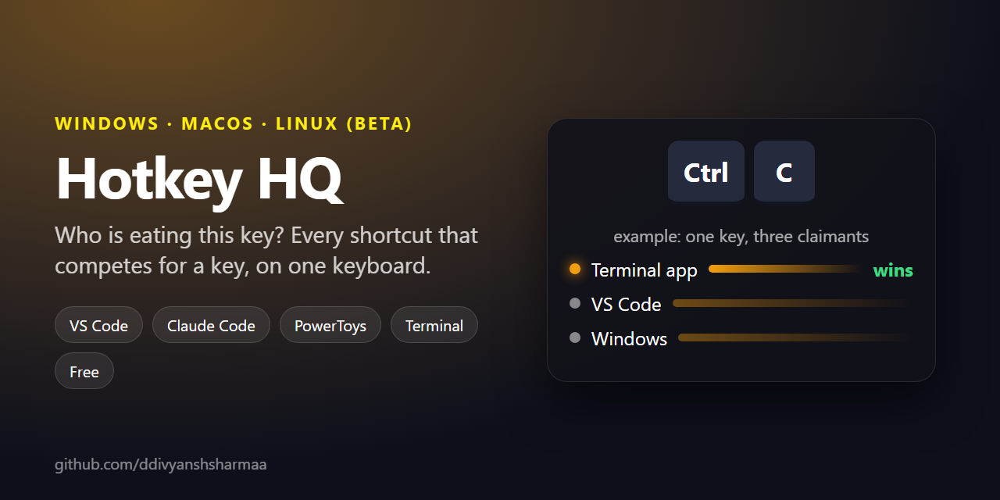

<div align="center">

# ⌨️ Hotkey HQ

**Who is eating this key?**
See every keyboard shortcut that competes for a key on your machine (Claude Code, VS Code, the OS, terminal apps, PowerToys and your own bindings) on one keyboard you can press keys against.

[](LICENSE)
[](https://github.com/ddivyanshsharmaa/hotkey-hq/commits)
[](https://github.com/ddivyanshsharmaa/hotkey-hq/stargazers)




[Windows setup](#windows-setup) · [What it does](#what-it-does) · [Privacy and safety](#privacy-and-safety)

</div>

Every keyboard shortcut competing for a key on your machine — Claude Code,
VS Code, the operating system, terminal apps, and your own bindings — on a
single keyboard you can press keys against. On Windows this includes PowerToys
and Windows Terminal.

Windows keeps the original implementation. macOS and Linux support is **beta:
built and checked on Windows with automated tests and syntax/type checks; not
yet tested on real Mac/Linux hardware**. The non-Windows defaults are a selected
platform reference, not an exhaustive scan of installed apps or OS settings.

It answers the question you actually have when a shortcut misbehaves: **who is
eating this key?**

## When to reach for it

- A shortcut stopped working and you do not know which app grabbed it.
- You want a **free key combination** that nothing on your machine claims.
- You use PowerToys and suspect it is **shadowing an app shortcut**.
- You want to assign or remove **VS Code or Claude Code keybindings** and see conflicts first.

## Windows setup

1. Run **`setup.bat`** once. It needs Python 3 and creates a private `.venv`
   folder with one dependency ([pywebview](https://pywebview.flowrl.com/)).
2. Run **`launch.bat`** to start it. It opens as its own desktop window.

To get a Start Menu / Desktop icon, right-click `launch.bat` → Send to → Desktop,
then set the icon to `icon.ico` in the shortcut's Properties.

If nothing appears when you launch it, open `hotkey-hq.log` in this folder — every
startup failure is recorded there, and anything fatal also shows a message box.

## macOS setup (beta)

Requirements: Python 3.10+ with `venv` and `pip`, Bash (the system Bash is fine),
and a graphical login session. pywebview installs its Cocoa/PyObjC dependencies;
the app uses Cocoa/WKWebView. Installation downloads packages; running the app
uses only the local loopback server.

From the repository folder:

```bash
bash setup.sh
bash launch.sh
```

Scripts also work from another directory: `bash "/path with spaces/hotkey-hq/launch.sh"`.
Keep the terminal open while using the app; startup errors are printed there and
logged in `hotkey-hq.log`.

No Accessibility, Input Monitoring or administrator permission is required:
Hotkey HQ observes keys only in its focused window. It needs ordinary read access
to the config files below, and write access when you explicitly assign/remove a
binding, export, or restore a backup. If a vault is in a protected Documents or
Desktop folder, macOS may ask for access to that folder for export/restore.
Grant only that folder access if you want the feature; Full Disk Access is not
required by this app.

Command and Control remain separate. Option is displayed as Option; terminal
Option-as-Meta behaviour depends on that terminal's settings. OS shortcuts such
as Cmd+Space and native window/menu shortcuts may never reach the page, even
with Capture on. Fn/Globe and hardware controls cannot be captured/rebound here.

## Linux setup (beta)

Requirements: Python 3.10+ with `venv` and `pip`, Bash, a graphical X11 or Wayland
session, PyGObject, GTK 3 and WebKitGTK 4.1. The app selects pywebview's GTK backend.
For Debian/Ubuntu, install the system GUI dependencies first:

```bash
sudo apt install python3-venv python3-pip python3-gi python3-gi-cairo gir1.2-gtk-3.0 gir1.2-webkit2-4.1
bash setup.sh
bash launch.sh
```

On other distributions install the equivalent packages before `setup.sh`.
Use the distribution's Python (`PYTHON=/usr/bin/python3 bash setup.sh` if needed)
so it can import the packaged `gi` bindings. The Linux virtual environment uses
`--system-site-packages` for those bindings. Setup checks imports and reports
missing GTK/WebKitGTK packages; it never invokes a package manager or sudo itself.

No root, input-group membership, global keyboard hook or input permission is
needed at runtime. Config files must be readable by your user; explicit edits,
export and restore need write access. Wayland's global shortcut restrictions do
not prevent this focused-window reference tool from running, but the compositor
or window manager can consume shortcuts before the page sees them.

OS rows are labelled **GNOME defaults**. KDE, tiling window managers, distribution
overrides and custom desktop shortcuts are not detected. Super labels the
Windows-logo key. A combo listed as unclaimed is only unclaimed in the loaded
reference and saved config overrides, not guaranteed available system-wide.

### Config files on macOS and Linux

| Source | macOS | Linux |
| --- | --- | --- |
| Claude Code | `~/.claude/keybindings.json` | `~/.claude/keybindings.json` |
| VS Code (stable, default profile) | `~/Library/Application Support/Code/User/keybindings.json` | `$XDG_CONFIG_HOME/Code/User/keybindings.json` |
| Obsidian vault registry | `~/Library/Application Support/obsidian/obsidian.json` | `$XDG_CONFIG_HOME/obsidian/obsidian.json` |
| kitty saved overrides | `$XDG_CONFIG_HOME/kitty/kitty.conf` | `$XDG_CONFIG_HOME/kitty/kitty.conf` |
| iTerm2 saved global/profile overrides | `~/Library/Preferences/com.googlecode.iterm2.plist` (XML or binary) | Not applicable |

An unset, empty or relative `XDG_CONFIG_HOME` falls back to `~/.config`.
Obsidian hotkeys come from `.obsidian/hotkeys.json` in the most recent vault,
with `Mod` meaning Cmd on macOS and Ctrl on Linux. Claude Code and VS Code
Assign/Remove use the same existing writers and backups, with platform modifier
names. PowerToys and the Windows NVIDIA overlay are hidden on both platforms;
Excel and Notion desktop defaults are also hidden on Linux.

Terminal imports are **read-only, partial saved-config readers**, not active
session detection. kitty supports ordinary single-key `map` entries,
`kitty_mod`, overrides, `clear_all_shortcuts yes` and `no_op` unmapping. Includes,
generated configs, sequences, conditional maps and unsupported key names are
skipped and counted in the on-page notes. iTerm2 shows global and named profile
maps, including inactive profiles, with numeric action IDs rather than guessing
their meanings. Custom iTerm2 preference folders and dynamic profiles are not
read. Terminal.app, GNOME Terminal and Konsole custom bindings are not imported.
kitty's `--config`/`KITTY_CONFIG_DIRECTORY` overrides and physical modifier
remapping are not discovered. iTerm2's two-, three- and four-part character-key
encodings are supported; physical-key identity, tmux/leader and numeric-keypad
bindings are not modelled. Live capture uses a generic US ANSI physical layout;
international layouts and VS Code scan-code bindings may display differently.
VS Code Insiders, named profiles, portable installs and sandboxed config paths
(including Flatpak/Snap Obsidian) are not discovered.

Backups/restore cover Claude Code, VS Code, kitty.conf and the selected Obsidian
vault on macOS/Linux. Binary iTerm2 preferences are deliberately excluded from
the text snapshot format. Launch takes a local snapshot when supported config
contents have changed; assignments do not take an additional snapshot automatically,
so use Backups before editing if you need an exact restore point. No keybinding
file is changed just by launching the app. Browser/native webview accelerators
and platform-specific layout behaviour still need testing on real hardware.

## What it reads from your machine

Nothing is bundled about *your* setup — it is all read live, every time the page
loads, from the config files you already have:

| Source | Where it comes from |
| --- | --- |
| Your Claude Code bindings | `~/.claude/keybindings.json` |
| Your VS Code bindings | `%APPDATA%\Code\User\keybindings.json`, including `-command` entries that switch a default off |
| Your PowerToys hotkeys | `%LOCALAPPDATA%\Microsoft\PowerToys\*\settings.json` — **modules you have disabled are ignored**, so a switched-off module is never reported as stealing a key |
| Your Windows Terminal bindings | Windows Terminal's `settings.json` (stable or Preview) |

The Claude Code, VS Code, Windows, text-editing and PowerShell *defaults* are a
hand-maintained table. The version it was checked against is printed at the bottom
of the app, so you can tell when it has gone stale.

## What it does

- **Press any shortcut** and it names every layer that claims it, ranked by which
  one actually wins. `Ctrl+C` is three different things depending on focus.
- **Hold Ctrl / Alt / Shift** and the board lights up every key that combination
  unlocks, coloured by the app that owns it.
- **Click a key** for every combination that uses it.
- **Capture mode** (on by default) swallows shortcuts so they get explained
  instead of executed. Turn it off when you want Ctrl+C to actually copy. Tab is
  never swallowed, so the app stays usable without a mouse.
- **Find a free combo** — this finds combinations nothing on the machine claims.
- **Assign bindings** to Claude Code or VS Code, and remove them again.
- **Conflict detection** — flags where an enabled PowerToys module silently
  shadows an app shortcut.

## Keyboard layouts

Pick your board from the dropdown: laptop with numpad, laptop without, tenkeyless,
or 65%. The **Fn** toggle adds the Fn key and marks F1–F12 as shared with hardware
controls.

## What it deliberately cannot do

Some keys never reach any application, so no software can intercept them:

- **`Win+`anything, `Alt+Tab`, `Alt+F4`, `Ctrl+Alt+Del`, `Ctrl+Shift+Esc`** —
  Windows claims these before any app sees them.
- **PowerToys hotkeys** — PowerToys uses a system-wide keyboard hook that runs
  ahead of the focused window. The app lists them and flags the conflicts, but
  cannot stop them firing.
- **The `Fn` key** — resolved inside the keyboard's own firmware. It never sends
  anything to Windows at all. Click the Fn key in the app for the full
  explanation.

Beating those would require installing a global low-level keyboard hook — the
same mechanism keyloggers use, capturing every keystroke in every application.
That is not a reasonable trade for a reference tool, so it isn't done. Capture
only works while the Hotkey HQ window has focus.

## Privacy and safety

Everything is local. The app runs a small HTTP server bound to `127.0.0.1` and
nothing is sent anywhere.

Because a local server is reachable by any web page your browser has open, every
API call must present a one-time token that the server injects into the page as it
serves it, and requests carrying another site's `Origin` are refused. A website
cannot use this app to touch your keybindings.

Those two checks are the actual defence, not a secret. Reading this source tells
you how they work and does not help you past them: the token is regenerated every
run and never leaves the page it was served to, and the `Origin` rule is enforced
on the server. Nothing here relies on you not knowing how it works.

### What it writes

Keybinding files change only when you ask. The app also writes a local runtime
log and takes a snapshot on launch when supported config contents have changed:

| When you | It writes |
| --- | --- |
| Click Assign or Remove | `~/.claude/keybindings.json`, or VS Code's `keybindings.json` — taking a one-time backup of the VS Code one first, since that file may contain comments that are lost when it is rewritten as plain JSON |
| Resolve a PowerToys conflict | That module's `settings.json`, after a one-time `.hotkeyhq-backup` copy beside it |
| Export a cheat sheet | One Markdown file inside your Obsidian vault |
| Launch, click Back up now, or restore | A timestamped copy of supported keybinding files into `snapshots/` when contents have changed. Restoring rewrites the files that snapshot covers; use Backups before an edit if you need an exact restore point |

Rebinding a PowerToys hotkey also **restarts PowerToys** — a `taskkill /F` on
`PowerToys.exe` followed by relaunching it. PowerToys reads most hotkeys once at
module start, so editing its settings file without a restart leaves the old key
live and the app silently wrong about who owns it. This happens only on that one
action, never on launch.

## Running it twice

Launching again while it is already running just opens another window onto the
same instance. A copy running from a *different* folder is left alone and the new
one takes the next free port, so an old install can never serve you its stale
interface.

## Files

| File | What it is |
| --- | --- |
| `index.html` | The whole interface — layout data, shortcut database, all logic |
| `server.py` | Local server, config readers/writers, opens the native window |
| `platform_config.py` | macOS/Linux paths and read-only terminal parsers (standard library) |
| `platform_data.js` | macOS/Linux shortcut reference and modifier labels |
| `requirements.txt` | The single pinned dependency |
| `setup.bat` | One-time environment setup |
| `launch.bat` | Starts the app |
| `setup.sh`, `launch.sh` | macOS/Linux environment setup and launch |
| `tests/` | Fixture-only checks; never read your personal app configs |
| `icon.ico` | App icon |
| `LICENSE` | MIT licence |
| `hotkey-hq.log` | Written at runtime; startup failures land here |
| `snapshots/` | Written at runtime; timestamped copies of your keybinding files |

## Development checks

No test dependencies are needed. Run these from the repository folder:

```text
python -m py_compile server.py platform_config.py tests/test_platforms.py
python -m unittest discover -s tests -v
node --check platform_data.js
node tests/test_frontend.js
bash -n setup.sh launch.sh
```

Node is only needed for the optional interface checks, not to run the app. Tests
use temporary fixture homes inside the repository, start a loopback server,
fetch its page/API, and exercise token/origin checks and config writes/restores.
The JavaScript checks execute the page against a small DOM double; they do not
prove native Cocoa/GTK rendering or OS keyboard capture.

Platform implementation references: [pywebview installation](https://pywebview.flowrl.com/guide/installation.html),
[VS Code modifier syntax](https://code.visualstudio.com/docs/configure/keybindings),
[VS Code platform defaults](https://code.visualstudio.com/docs/reference/default-keybindings),
[Claude Code modifier syntax](https://code.claude.com/docs/en/keybindings),
[kitty configuration](https://sw.kovidgoyal.net/kitty/conf/),
[iTerm2 key mapping source](https://github.com/gnachman/iTerm2/blob/master/sources/Keyboard/iTermKeyMappings.m),
[iTerm2 keystroke source](https://github.com/gnachman/iTerm2/blob/master/sources/Keyboard/iTermKeystroke.m),
[Obsidian storage locations](https://help.obsidian.md/Files+and+folders/How+Obsidian+stores+data),
[macOS shortcuts](https://support.apple.com/en-us/102650), and
[GNOME shortcuts](https://help.gnome.org/gnome-help/shell-keyboard-shortcuts.html).

## Licence

MIT — see [LICENSE](LICENSE). Use it, fork it, ship it, sell it; just keep the
copyright notice.

The single dependency, [pywebview](https://pywebview.flowrl.com/), is BSD-3 and
is installed into your own `.venv` rather than bundled here.

The shortcut *defaults* tables are a hand-compiled reference to what Windows,
VS Code, Claude Code, PowerToys and the rest ship with. Those product names
belong to their owners and appear here only to say whose shortcut is whose.

---

If this saved you time, a ⭐ on the repo helps other people find it.

---

Built by [Divyansh Sharma](https://www.divyanshsharma.me), an AI automation and web developer in Jaipur, India. More of my work: [GitHub](https://github.com/ddivyanshsharmaa) · [LinkedIn](https://www.linkedin.com/in/ddivyanshsharmaa/) · [Substack](https://substack.com/@divyanshsharmaa) · [Website](https://www.divyanshsharma.me)
